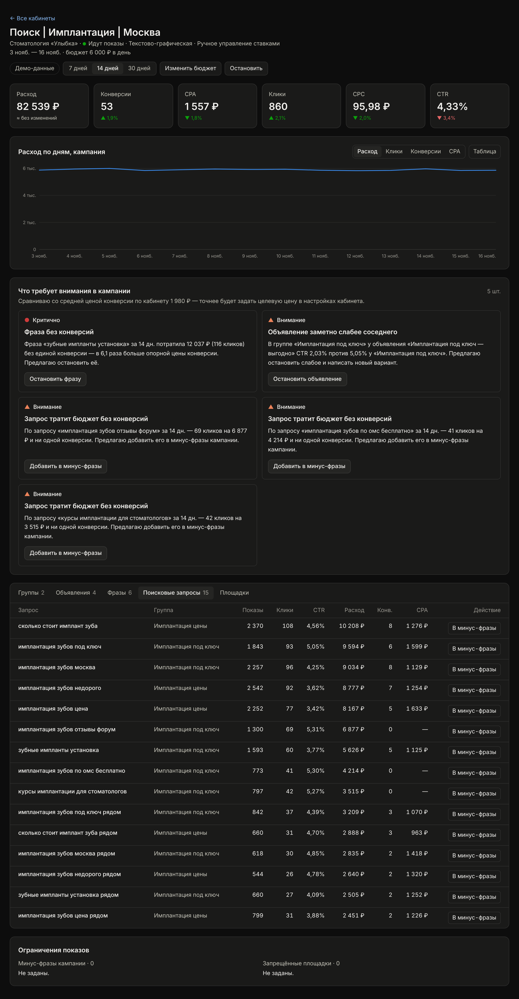

# Рекламный кабинет

Единый интерфейс для ведения рекламы в Яндекс Директе: сводка по всем кабинетам, разбор кампаний до фраз, запросов и площадок, рекомендации с объяснением на цифрах, управление и создание кампаний. Рассчитан на одного специалиста с одним логином, под которым ведутся клиентские кабинеты.


## Что умеет

**Сводка по всем кабинетам.** Расход, конверсии, CPA, клики, CPC, CTR с изменением к предыдущему такому же периоду (7, 14 или 30 полных дней до вчера), динамика по дням, журнал действий.

**Страница кампании.** Группы, объявления, ключевые фразы, поисковые запросы и площадки — со статистикой и действиями в каждой строке.



**Рекомендации.** Каждая объясняет, на каких цифрах сработала, и предлагает конкретное действие:

| Уровень | Что находит | Что предлагает |
|---|---|---|
| Кампания | Расход без конверсий | Остановить кампанию |
| Кампания | CPA в 1,6+ раза выше опорного | Снизить дневной бюджет на 20% |
| Кампания | CTR упал на 20%+ к прошлому периоду | Обновить объявления (без действия) |
| Кампания | CPA лучше опорного и расход упирается в бюджет | Поднять бюджет на 20% |
| Запрос | Клики и расход без конверсий | Добавить в минус-фразы |
| Площадка | Клики и расход без конверсий | Запретить показы |
| Фраза | Расход без конверсий / CPA в 2+ раза выше опорного | Остановить / снизить ставку на 20% |
| Объявление | CTR заметно ниже лучшего в группе | Остановить |

Опорная цена конверсии — целевой CPA из настроек кабинета; если он не задан, берётся средняя цена по кабинету. Пороги собраны в `RULES` в `src/lib/ads/insights.ts`.

**Управление.** Пауза и запуск кампаний, объявлений и фраз; дневной бюджет; ставки фраз; минус-фразы; запрет площадок. Любое изменение выполняется только после подтверждения и записывается в журнал.

**Создание кампаний.** Форма с проверкой лимитов Директа (длины заголовков и текстов, число слов во фразе). Кампания создаётся черновиком: показы и расход начинаются только после отдельной отправки на модерацию.

**Командная строка.** Те же данные и действия в виде JSON — для работы из терминала или из сессии Claude:

```bash
npm run ads -- accounts
npm run ads -- audit --days 14
npm run ads -- campaign <кабинет> <кампания> --levels keywords,queries
npm run ads -- apply '{"accountId":"…","campaignId":"…","action":{"type":"pause","target":"campaign","id":"…"}}'
npm run ads -- create plan.json
```

`audit` обходит все кабинеты и активные кампании и возвращает полный список рекомендаций.

## Запуск

```bash
npm install
npm run dev
```

Откроется на http://localhost:3000. Без настройки кабинет работает на **демо-данных**: три выдуманных проекта. В демо-режиме все действия меняют только демонстрационные данные.

Проверки:

```bash
npm test
npm run typecheck
npm run lint
```

## Подключение Яндекс Директа

1. Зарегистрировать приложение в Яндекс OAuth с доступом к API Директа.
2. Подать заявку на доступ: в Директе раздел API → «Получить доступ к API» → «Мои заявки» → «Новая заявка». По документации Яндекса рассмотрение занимает от часа до трёх рабочих дней, в пиковые периоды — до семи.
3. Получить OAuth-токен для своего логина.
4. Скопировать `.env.example` в `.env.local` и вписать токен в `YD_TOKEN`.

Список кабинетов определяется автоматически: для агентского логина — его клиенты (каждый запрос к данным клиента идёт с заголовком `Client-Login`), иначе — собственный аккаунт. Если автоопределение не подошло, логины клиентов можно перечислить в `YD_CLIENT_LOGINS`.

**Боевые кабинеты по умолчанию открываются только на чтение.** Изменения включаются отдельно: `ADS_ALLOW_WRITE=1`.

## Выкладка на сервер

Перед тем как открыть кабинет из сети, обязательно задайте `ADS_PASSWORD` — без него страницы и API доступны всем, кто знает адрес. Настройки кабинетов и журнал лежат в файле `data/cabinet.json`; каталог должен сохраняться между перезапусками.

## Как устроено

| Слой | Файлы | Что делает |
|---|---|---|
| Интерфейс | `src/components/ads/` | Сводка, страница кампании, форма создания, вход |
| API | `src/app/api/` | Маршруты для интерфейса; `src/proxy.ts` — вход по паролю |
| Сервис | `src/lib/ads/service.ts` | Сводка, детализация, действия, создание кампаний, кеш на 5 минут |
| Правила | `src/lib/ads/insights.ts` | Рекомендации на уровне кампаний и внутри кампании |
| План кампании | `src/lib/ads/plan.ts` | Проверка плана по лимитам Директа |
| Площадки | `src/lib/ads/providers/` | Контракт `AdsProvider`, клиент Яндекс Директа, демо-данные |
| Хранение | `src/lib/ads/store.ts` | Настройки кабинетов и журнал действий в JSON-файле |
| Командная строка | `scripts/ads.mts` | Доступ к сервису без интерфейса |

Новая площадка (VK Реклама) добавляется одной реализацией `AdsProvider` — сводка, правила, интерфейс и командная строка её подхватывают.

## Что проверено и что нет

Проверено тестами и в браузере на демо-данных: расчёты, правила, сценарии управления и создания, вход по паролю, хранение. Формат запросов к API Директа проверен тестами с подменным сетевым слоем; структуры сверены с официальным справочником.

**Не проверено на живом кабинете.** С настоящим токеном клиент ещё не запускался. При первом подключении нужно, оставаясь в режиме «только чтение», проверить:

- что кабинеты определились верно — это зависит от того, как именно логину выданы доступы к клиентам;
- что цифры совпадают с интерфейсом Директа, в том числе конверсии (влияют цели и модель атрибуции из настроек кабинета);
- что отчёты по адресу v5 включают статистику единых перфоманс-кампаний;
- затем, уже с разрешёнными изменениями, — создание кампании на тестовом черновике.

## Ограничения текущей версии

- Недельный бюджет и параметры автостратегий показываются, но не редактируются.
- Создаются только единые перфоманс-кампании с текстовыми объявлениями; изображения, быстрые ссылки, уточнения и товарные объявления не поддержаны.
- Редактирования текстов существующих объявлений нет — только пауза и запуск.
- Минус-фразы и запрет площадок работают на уровне кампании, не группы.
- Корректировки ставок, расписание показов и условия ретаргетинга не поддержаны.
- Анализ выполняют фиксированные правила; автономного режима по расписанию пока нет — действия подтверждает человек.
- Общие суммы предполагают одну валюту; при разных валютах интерфейс предупреждает, что итог приблизителен.
