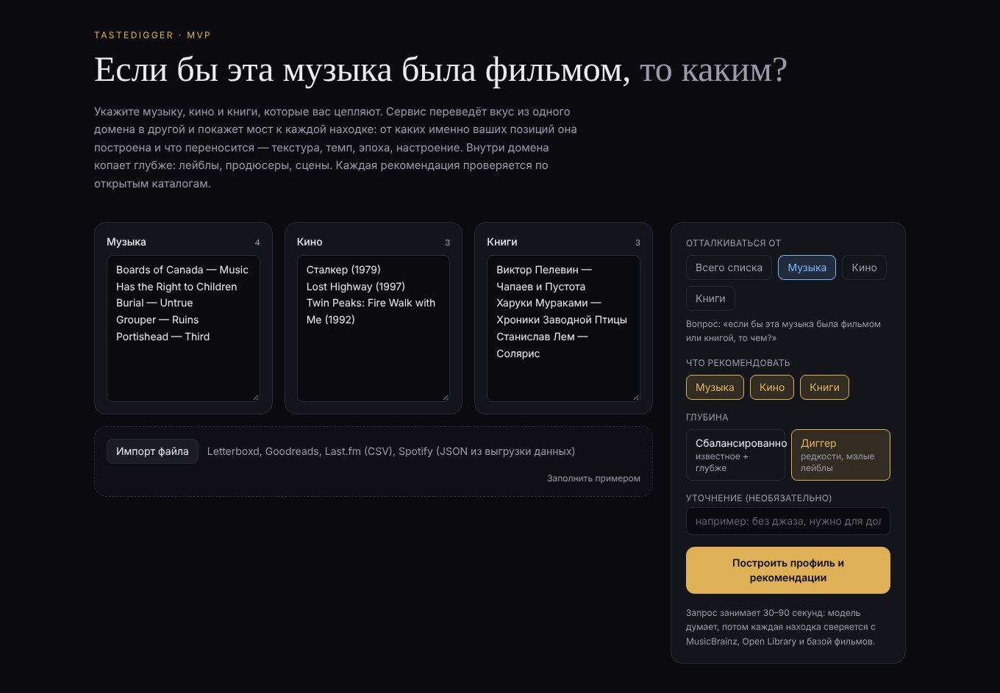
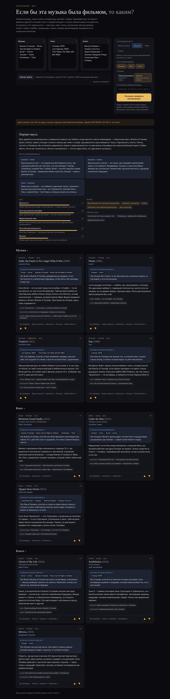
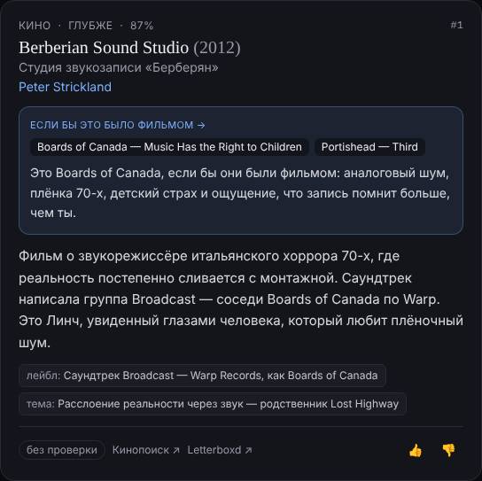

# TasteDigger — MVP рекомендательного сервиса с объяснениями

Веб-сервис, который отвечает на вопрос «если бы эта музыка была фильмом, то каким?». Вы указываете музыку, кино и книги, которые любите, выбираете, от какого домена отталкиваться, и получаете: портрет вкуса, карту переводов вкуса между доменами («ваша музыка в кино — это…») и находки, у каждой из которых виден мост — от каких именно ваших позиций она построена и что переносится (текстура, темп, эпоха, настроение). Внутри домена сервис копает глубже: лейбл, продюсер, сцена, экранизация. Каждая рекомендация проверяется по открытым каталогам, чтобы отсечь выдуманные произведения.



## Запуск

```bash
npm install
cp .env.example .env.local   # вписать ANTHROPIC_API_KEY
npm run dev                  # http://localhost:3000
```

Без ключа приложение работает в **демо-режиме**: показывает заранее подготовленный пример ответа, чтобы можно было оценить интерфейс.



Карточка с мостом между доменами:



## Как устроено

| Слой | Файлы | Что делает |
|---|---|---|
| UI | `src/components/TasteApp.tsx`, `RecCard.tsx`, `ProfileView.tsx` | Форма ввода (текст + импорт файлов), настройки, вывод профиля и карточек |
| Импорт | `src/lib/parsers.ts` | Letterboxd / Goodreads / Last.fm (CSV), Spotify (JSON), произвольный текст |
| Модель | `src/lib/claude.ts`, `src/lib/prompt.ts`, `src/lib/types.ts` | Вызов Claude со структурированным выводом (Zod-схема), промпт куратора |
| Проверка | `src/lib/grounding/*` | MusicBrainz (музыка), Open Library (книги), TMDB или Wikipedia (кино) |
| Ссылки | `src/lib/links.ts` | Поиск на Яндекс Музыке, Bandcamp, Discogs, Кинопоиске, Литрес, Букмейте |
| API | `src/app/api/recommend/route.ts` | `POST /api/recommend` — склеивает всё вместе |

### Формат запроса

```json
{
  "music": ["Burial — Untrue"],
  "film": ["Сталкер (1979)"],
  "book": [],
  "want": ["music", "book"],
  "from": "music",
  "depth": "digger",
  "note": "без джаза",
  "verify": true
}
```

`from` — домен, от которого строить мосты (`music | film | book | all`).

Ответ содержит `profile` (портрет вкуса: оси 0–100, опоры, слепые зоны, `translations` — формулы перевода между доменами) и `recommendations` (домен, название, автор, год, объяснение, связи, `bridge` — от каких позиций пользователя построен мост и фраза-перевод, глубина, уверенность, статус проверки `verified | not_found | unavailable | skipped`, ссылки на площадки).

## Переменные окружения

- `ANTHROPIC_API_KEY` — обязателен для реальных рекомендаций.
- `CLAUDE_MODEL` — модель, по умолчанию `claude-opus-5-5`.
- `TMDB_API_KEY` — необязателен; без него фильмы проверяются поиском по Wikipedia.

## Что намеренно не сделано в MVP

- Нет аккаунтов и сохранения профиля: оценки 👍/👎 живут только в сессии браузера.
- Нет оплаты.
- Нет прямого подключения к Яндекс Музыке / Spotify: импорт только через файлы выгрузки. Spotify с 2025–2026 годов фактически закрыл API для новых приложений, поэтому это осознанное решение.
- Персональные данные в модель не уходят: только списки произведений.

## Следующие шаги

1. Запустить с реальным ключом и прогнать 20–30 своих профилей, собрать «в точку / мимо».
2. Сохранять профиль и историю оценок (SQLite или Postgres), чтобы не советовать повторно.
3. Платный «глубокий режим» (ЮKassa / CloudPayments), лимит бесплатных запросов.
4. Расширить проверку: Discogs API для лейблов и credits, Кинопоиск через неофициальный API.
