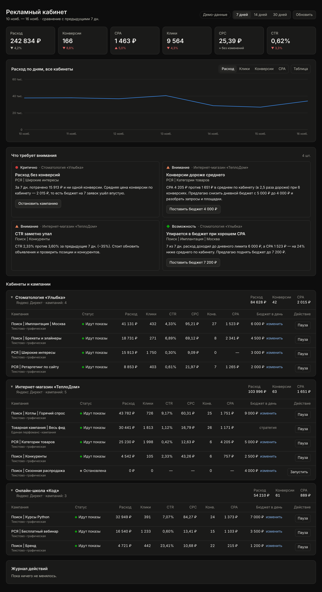

# Рекламный кабинет

Единый интерфейс для ведения рекламы: сводная аналитика по всем кабинетам и проектам, рекомендации с объяснением на цифрах и управление кампаниями из одного окна. Сейчас поддержан Яндекс Директ; архитектура рассчитана на добавление VK Рекламы.



## Что умеет сейчас

- **Сводка по всем кабинетам**: расход, конверсии, CPA, клики, CPC, CTR — с изменением к предыдущему такому же периоду (7, 14 или 30 полных дней до вчера).
- **Динамика по дням**: график по выбранному показателю и табличный вид.
- **«Что требует внимания»** — базовые правила директолога, каждое объясняет, на каких цифрах сработало:
  - расход без конверсий → предлагает остановить кампанию;
  - конверсии в 1,6+ раза дороже среднего по кабинету → предлагает снизить дневной бюджет на 20%;
  - CTR упал на 20%+ к прошлому периоду → сигнал обновить объявления;
  - кампания окупается лучше среднего и упирается в дневной бюджет → предлагает поднять его на 20%.
- **Управление**: пауза, запуск, изменение дневного бюджета. Любое действие выполняется только после подтверждения человеком и попадает в журнал.

## Запуск

```bash
npm install
npm run dev
```

Откроется на http://localhost:3000. Без настройки кабинет работает на **демо-данных** — три выдуманных проекта, чтобы оценить интерфейс и логику. В демо-режиме действия меняют только демонстрационные данные.

Проверки:

```bash
npm test
npm run typecheck
npm run lint
```

## Подключение Яндекс Директа

1. Зарегистрировать приложение в Яндекс OAuth (oauth.yandex.ru/client/new) с доступом «Использование API Яндекс Директа» (`direct:api`).
2. Подать заявку на доступ к API в интерфейсе Директа: раздел API → «Мои заявки» → «Новая заявка», указать идентификатор приложения. Одна заявка на одно приложение.
3. После одобрения получить OAuth-токен для каждого логина (или один агентский токен).
4. Скопировать `.env.example` в `.env.local` и описать кабинеты:

```bash
ADS_ACCOUNTS=[{"id":"project-a","name":"Проект А","tokenEnv":"YD_TOKEN_A"}]
YD_TOKEN_A=<токен>
```

Для агентского токена у каждого клиента указывается `login`. Поле `"sandbox": true` переключает кабинет на песочницу API.

**Боевые кабинеты по умолчанию открываются только на чтение.** Пауза, запуск и изменение бюджета включаются отдельно: `ADS_ALLOW_WRITE=1`.

## Как устроено

| Слой | Файлы | Что делает |
|---|---|---|
| Интерфейс | `src/components/ads/Dashboard.tsx`, `TrendChart.tsx` | Сводка, график, рекомендации, таблицы кампаний, подтверждение действий |
| API | `src/app/api/ads/overview/route.ts`, `actions/route.ts` | `GET /api/ads/overview?days=7`, `POST /api/ads/actions` |
| Сводка | `src/lib/ads/service.ts` | Конфигурация кабинетов, сбор данных по всем кабинетам, кеш на 5 минут, журнал действий |
| Правила | `src/lib/ads/insights.ts` | Рекомендации; пороги собраны в `RULES` |
| Площадки | `src/lib/ads/providers/` | Общий контракт `AdsProvider`, клиент Яндекс Директа, демо-данные |
| Метрики | `src/lib/ads/metrics.ts` | Суммы, производные метрики, периоды |

Новая площадка добавляется одной реализацией `AdsProvider` (три метода) — сводка, правила и интерфейс её подхватывают без изменений.

## Что проверено и что нет

- Проверено: логика метрик, правил и сводки, разбор отчётов Директа, формат запросов к API (тесты с подменным сетевым слоем), интерфейс в браузере на демо-данных.
- **Не проверено на живом кабинете**: клиент Яндекс Директа написан по официальной документации, но с настоящим токеном ещё не запускался. Первое подключение нужно делать в режиме «только чтение» и сверить цифры с интерфейсом Директа.

## Ограничения текущей версии

- Конверсии берутся суммой по всем целям кабинета; выбора целей и модели атрибуции пока нет.
- Дневной бюджет меняется только у кампаний, где он уже задан (ручная стратегия). Недельный бюджет автостратегий пока не редактируется.
- Журнал действий и изменения демо-режима хранятся в памяти процесса и теряются при перезапуске — базы данных пока нет.
- Нет авторизации: до выкладки на сервер интерфейс нужно закрыть паролем, иначе управление рекламой окажется доступно любому, кто знает адрес.
- Уровни ниже кампании (группы, объявления, ключевые фразы, поисковые запросы, площадки) пока не выводятся.
- Общие суммы предполагают одну валюту; при разных валютах интерфейс предупреждает, что итог приблизителен.
